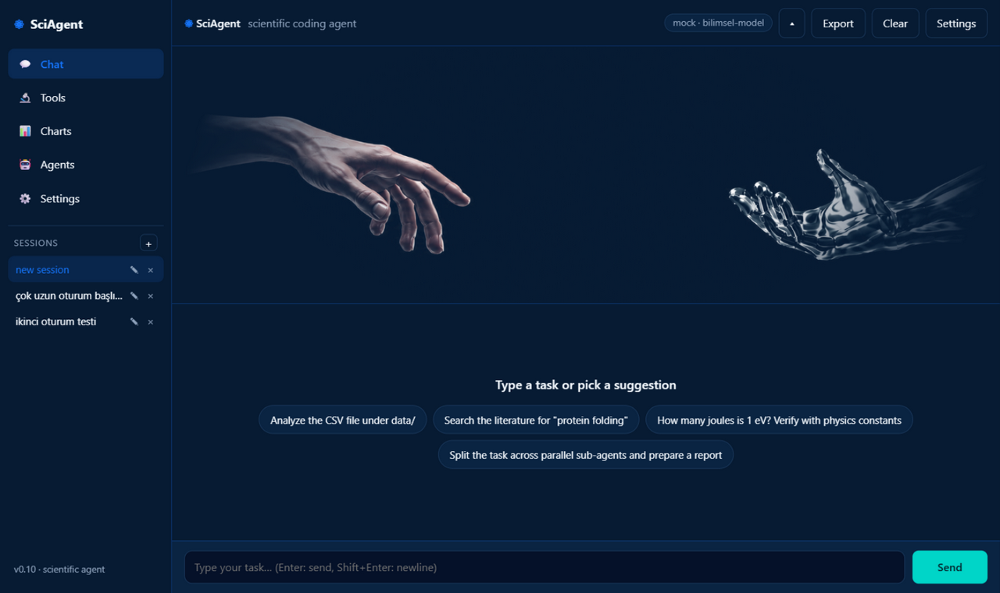
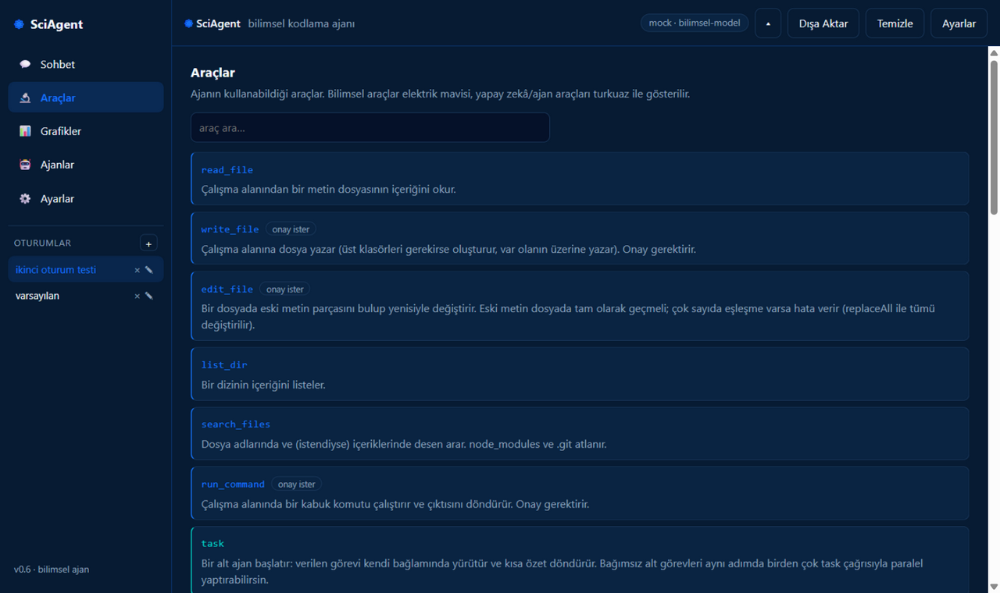
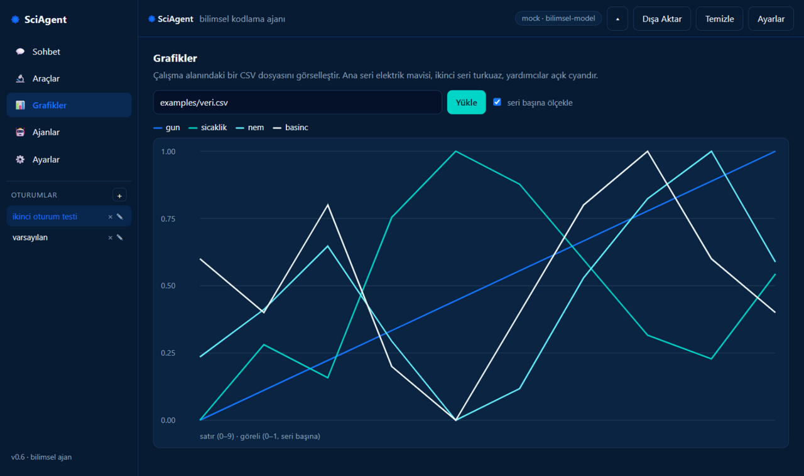

<div align="center">
  
</div>

Model-bağımsız, Claude benzeri bütünleşik bir kodlama ajanı: **çekirdek motor + CLI + masaüstü arayüz**. Özel bilimsel modelinizi OpenAI uyumlu bir API üzerinden bağlarsınız; ajan dosya okuma/yazma, arama ve terminal komutlarını **onay mekanizmasıyla** çalıştırır.

## Ekran Görüntüleri

| Sohbet + Hero | Araçlar |
|---|---|
|  |  |
| **Grafikler** | **Ajanlar** |
|  |  |

## Mimari

```
sci-agent/
├─ packages/
│  ├─ core/      # Ajan motoru: sağlayıcı arayüzü, araç sistemi, onay politikası, döngü
│  ├─ cli/       # Terminal arayüzü (sci-agent komutu)
│  └─ desktop/   # Yerel sunucu (SSE) + web arayüzü + Electron kabuğu
└─ test/         # node:test ile otomatik testler
```

- **Model-bağımsız:** Herhangi bir OpenAI uyumlu uç nokta (vLLM, Ollama, HF TGI, LM Studio, bulut API'leri…).
- **Ajan döngüsü:** Model → araç çağrısı → sonuç → model … (adım sınırıyla).
- **Paralel alt-ajanlar:** Model aynı adımda birden çok `task` çağrısı verirse alt ajanlar **eşzamanlı** yürütülür; her alt ajan kendi bağlamında çalışır, özetini ana ajana döndürür. Alt ajanlar iç içe `task` başlatamaz.
- **Eklenti sistemi:** `packages/core/src/plugins.js` içindeki kancayla araç takımları ve sistem istemi eklemeleri yapılandırma değiştirmeden yüklenir (bkz. "Bilimsel model geldiğinde").
- **Akışlı yanıtlar:** `model.stream` (varsayılan `true`) ile metin ve akıl yürütme deltaları canlı gösterilir; sunucu akışı reddederse bir kez akışsız denenir.
- **Onay politikası:** `read_file`, `list_dir`, `search_files`, `csv_stats` otomatik; `write_file`, `edit_file`, `run_command`, `python_eval` varsayılan olarak **onay ister** (politika `sci-agent.config.json` ile değiştirilebilir).
- **Çalışma alanı sanal kutusu:** Araçlar yapılandırılan kökün dışına erişemez.

## Kurulum

```bash
npm install
```

Masaüstü uygulaması için (Electron ikilisini indirir):

```bash
npm install --save-dev electron --workspace packages/desktop
```

## Model bağlama

1. `sci-agent.config.example.json` dosyasını `sci-agent.config.json` olarak kopyalayın ve düzenleyin (bu dosya git'e girmez).
2. Ya da ortam değişkenleri: `SCI_AGENT_BASE_URL`, `SCI_AGENT_API_KEY`, `SCI_AGENT_MODEL`, `SCI_AGENT_PROVIDER`.
3. Ya da masaüstü arayüzünde **Ayarlar** panelinden girin.

Örnek — Ollama:

```bash
SCI_AGENT_BASE_URL=http://localhost:11434/v1 SCI_AGENT_MODEL=komut-satiri-modeli npm run cli
```

Örnek — vLLM üzerinde barındırılan bilimsel model:

```bash
SCI_AGENT_BASE_URL=http://sunucu:8000/v1 SCI_AGENT_API_KEY=... SCI_AGENT_MODEL=bilimsel-model npm run server
```

Henüz model yoksa `SCI_AGENT_PROVIDER=mock` ile betikli sahte model kullanılabilir (arayüzü denemek için).

## Kullanım

```bash
npm run cli        # terminal ajanı (sci-agent)
npm run server     # tarayıcıda arayüz: http://127.0.0.1:8765
npm run desktop    # Electron penceresi
npm test           # otomatik testler
```

CLI komutları: `/help`, `/model`, `/tools`, `/sessions [no]`, `/save`, `/test`, `/clear`, `/exit`.
Tek seferlik görev: `node packages/cli/bin/sci-agent.js --prompt "görev"`.

## Araçlar

| Araç | Onay | Açıklama |
|---|---|---|
| `read_file` | hayır | Metin dosyası okur |
| `list_dir` | hayır | Dizin listeler |
| `search_files` | hayır | Ad/ içerik araması (regex) |
| `write_file` | evet | Dosya yazar/üzerine yazar |
| `edit_file` | evet | Bul-değiştir ile dosya düzenler (çoklu eşleşme koruması) |
| `run_command` | evet | Kabuk komutu çalıştırır |
| `task` | hayır* | Alt ajan başlatır; aynı adımdakiler paralel yürür (*alt ajanın tehlikeli çağrıları yine onay ister) |
| `python_eval` | evet | Python kodu çalıştırır (PATH'ten bağımsız Python çözücü: `pybridge`) |
| `csv_stats` | hayır | CSV sütunları için n/ortalama/ss/min/maks |
| `math_eval` | hayır | Güvenli matematik ifade değerlendirici (parser'lı, eval'siz) |
| `unit_convert` | hayır | Birim dönüşümleri (uzunluk, kütle, enerji, basınç, sıcaklık, açı…) |
| `physical_constants` | hayır | 22 fizik sabiti (CODATA, birimli) |
| `stats_calc` | hayır | Betimsel istatistik, Pearson korelasyonu, doğrusal regresyon |
| `matrix_ops` | hayır | Matris determinant, ters ve çarpım (Gauss eliminasyonu) |
| `molar_mass` | hayır | Formülden mol kütlesi — 118 element (IUPAC kütleleri, hidrat destekli) |
| `furox_compute` | evet | Kullanıcının bilimsel yığınıyla (numpy/scipy/pandas/cds2/axiomize) Python kodu |
| `axiomize_cli` | evet | axiomize CLI: modelleme IR, birim/boyut doğrulama, belirsizlik, SBML/CellML/Modelica |
| `cds2_cli` | evet | cds2 CLI (scientific-computing-system-2.0): lineer cebir, ODE/PDE, Monte Carlo, sinyal, kuantum sim. |
| `lit_search` | hayır | Literatür araması: OpenAlex + Europe PMC + Crossref eşzamanlı |
| `lit_verify` | hayır | Atıf eşleşme + retraksiyon/düzeltme kontrolü (DOI/başlık) |
| `lit_quote` | hayır | Tam metin alıntı eşleşmesi (PMCID + sha256 kanıtlı) |
| `plan_audit` | evet | plan-auditor CLI: mühürlü plan, kanıt zinciri, tamamlanma kapısı |

**Bilimsel eklentiler** (`sci-tools`, `sci-extra`, `sci-data`, `sci-chem`, `sci-furox`, `sci-quantum`, `sci-lit`, `sci-audit`) modele hesap yapma, literatür ve doğrulama gücü kazandırır: model işleri uydurmak yerine bu araçlarla yapar.

**Kullanıcının açık depolarından entegrasyon** (6 depo bağlı):
- [axiomize](https://github.com/Furox-Art/axiomize) + [scientific-computing-system-2.0](https://github.com/Furox-Art/scientific-computing-system-2.0) → `sci-furox` köprü araçları (pip)
- [quantum-reasoning-skill](https://github.com/Furox-Art/quantum-reasoning-skill) → `sci-quantum` akıl yürütme protokolü (prompt)
- [literature-evidence-mcp](https://github.com/Furox-Art/literature-evidence-mcp) → `sci-lit` literatür kanıt araçları (pip)
- [plan-auditor](https://github.com/Furox-Art/plan-auditor) → `sci-audit` plan doğrulama köprüsü (pip)
- [eq-layer](https://github.com/Furox-Art/eq-layer) → **otomatik ön-işleme**: her kullanıcı mesajında niyet/duygu routing'i çalışır, yönlendirme o turun sistem istemine eklenir (kalıcı geçmiş değişmez; `SCI_AGENT_EQ_DISABLE=1` ile kapatılır). Bilinçli olarak eklenmeyenler: scientific-computing-system v1 (2.0 zaten var), scientific-toolkit-mcp (bağımlılık çakışması riski), nomosguard/repocraft (bilimsel hesaplama kapsamı dışı). Kurulum:

```bash
pip install numpy scipy pandas axiomize scientific-computing-system-2.0 literature-evidence-mcp plan-auditor "eq-layer[ml]"
```

## Bilimsel model geldiğinde

Özel bilimsel modeliniz hazır olduğunda yapılacaklar kod değişikliği gerektirmez:

1. **Modeli bağla:** `sci-agent.config.json` içinde `baseUrl`, `name` (ve gerekirse `apiKey`) — ya da arayüzdeki Ayarlar paneli.
2. **Model-özellikli eklenti ekle:** `packages/core/src/plugins.js` içindeki `BUILTINS` kaydına yeni bir eklenti tanımla: `tools` (modele özgü araçlar) ve `systemPrompt` (modele özgü davranış). Eklentiyi config'deki `plugins` listesine yaz; çekirdek döngü ve arayüz aynı kalır.

Varsayılan sekiz eklenti (`sci-tools`, `sci-extra`, `sci-data`, `sci-chem`, `sci-furox`, `sci-quantum`, `sci-lit`, `sci-audit`) bu kancanın çalışan örnekleridir: 15 bilimsel/kanıt aracı + bilimsel davranış ve akıl yürütme istemleri.

## Yol haritası

- [x] Akış (streaming) yanıt desteği
- [x] Bul-değiştir düzenleme aracı (`edit_file`)
- [x] Paralel alt-ajanlar (`task`) ve eklenti mimarisi
- [x] Bilimsel araç seti: matematik-fizik (`sci-extra`), veri analizi (`sci-data`), kimya (`sci-chem`)
- [x] Kullanıcı depolarından köprü: axiomize + cds2 (`sci-furox`), quantum-reasoning (`sci-quantum`)
- [x] literature-evidence-mcp (`sci-lit`) ve plan-auditor (`sci-audit`) entegrasyonu
- [x] eq-layer otomatik yönlendirme katmanı (mesaj öncesi niyet/politika routing'i)
- [x] Çoklu oturum (uygulama + CLI paylaşımlı) ve sohbet geçmişi
- [x] Grafikler görünümü (CSV → çok serili çizgi grafiği), Ajanlar görev kartları

## Lisans

Çift lisans: **MIT OR Apache-2.0** — LICENSE-MIT ve LICENSE-APACHE dosyalarına bakın. Apache-2.0 patent hakkını açıkça verir; MIT kısa ve basittir, kullanıcı ikisinden birini seçebilir.

## Durum

v0.7 — çoklu oturum (uygulama + CLI paylaşımlı), Grafikler görünümü, Ajanlar görev kartları, markdown/kod render, sohbet dışa aktarma, model bağlantı testi ve araç arama filtresi eklendi. 73 test geçti (atlama yok). Gerçek model uç noktasıyla uçtan uca deneme, model bağlandığında yapılmalı.
